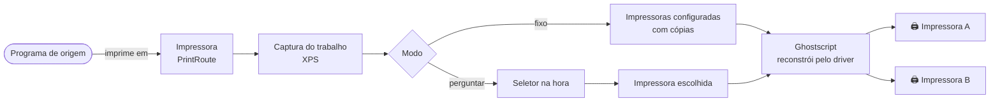
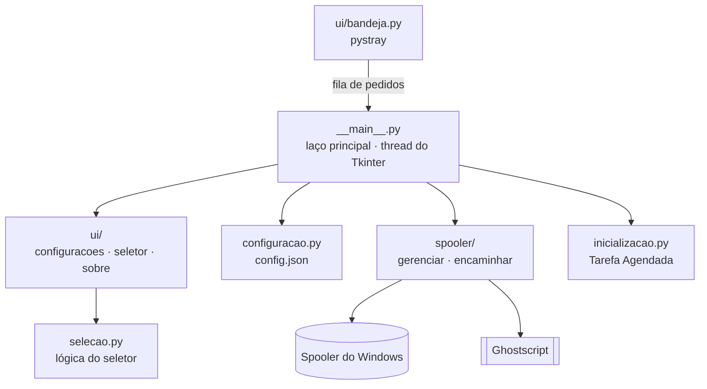

<!-- markdownlint-disable MD033 MD041 -->
<div align="center">

<a href="https://github.com/BrunodosSantosVaz/print-route/releases">
  
</a>

# PrintRoute

**Uma impressora virtual que reencaminha.**

O PrintRoute aparece no Windows como mais uma impressora. Quando um programa manda imprimir nela,<br>
ele encaminha a impressão para uma ou mais impressoras reais, pré-configuradas ou escolhidas na hora.

<br>

[](https://github.com/BrunodosSantosVaz/print-route/releases)
[](https://github.com/BrunodosSantosVaz/print-route/actions/workflows/ci.yml)
[](https://github.com/BrunodosSantosVaz/print-route/actions/workflows/codeql.yml)
[](LICENSE)
<br>
[](#-instalação)
[](pyproject.toml)
[](https://www.ghostscript.com/)
[](https://docs.astral.sh/ruff/)
[](#-estado-atual)

<br>

<a href="https://github.com/BrunodosSantosVaz/print-route/releases"></a>
<a href="#-como-usar"></a>
<a href="docs/processo.md"></a>
<a href="https://github.com/BrunodosSantosVaz/print-route/discussions"></a>

</div>

<!-- Capturas de tela: adicione imagens reais em docs/imagens/ e descomente.
<p align="center">
  
  
</p>
-->

<br>

<details>
<summary><b>Sumário</b></summary>

- [Para que serve](#-para-que-serve)
- [Estado atual](#-estado-atual)
- [Como funciona](#-como-funciona)
- [Instalação](#-instalação)
- [Como usar](#-como-usar)
- [Configuração](#-configuração)
- [Arquitetura](#-arquitetura)
- [Desenvolvimento](#-desenvolvimento)
- [Versões e releases](#-versões-e-releases)
- [Segurança](#-segurança)
- [Contribuindo](#-contribuindo)
- [Licença e avisos](#-licença-e-avisos)

</details>

## 🎯 Para que serve

Muitos sistemas legados ou parametrizáveis só permitem configurar **uma** impressora de saída (boletos, etiquetas, comprovantes...). Quando a impressão precisa ir para mais de um lugar, ou o destino muda conforme a situação, a única saída costuma ser reconfigurar o sistema toda vez.

O PrintRoute resolve isso por fora: ele se registra como uma impressora comum, então qualquer programa pode "imprimir" nele sem saber que existe um roteamento por trás.

<table>
<tr>
<td width="50%" valign="top">

### 🖨️ Impressoras fixas
Reencaminha para uma ou mais impressoras pré-configuradas, cada uma com seu número de cópias, sem intervenção.

</td>
<td width="50%" valign="top">

### 🪟 Seletor na hora
Abre um diálogo a cada impressão para escolher a impressora de destino e a quantidade de cópias.

</td>
</tr>
</table>

## ✅ Estado atual

**Publicado e funcional.** A captura, o reencaminhamento (uma ou mais impressoras, com cópias, reconstruindo o documento pelo driver de cada uma via Ghostscript), o seletor na hora, a configuração, o ícone na bandeja e o instalador (com desinstalador e elevação automática) existem e foram testados numa sessão de desktop real, não só pela CI (veja o [épico #3](https://github.com/BrunodosSantosVaz/print-route/issues/3)).

## 🔀 Como funciona



O documento capturado é reconstruído pelo **driver de cada impressora de destino** via Ghostscript/`ghostxps`, sem copiar bytes brutos. Isso evita documentos corrompidos em impressoras diferentes.

## 📦 Instalação

<a href="https://github.com/BrunodosSantosVaz/print-route/releases"></a>

1. Baixe e rode o instalador `PrintRoute-Setup-vX.Y.Z-windows-x64.exe` da página de [Releases](https://github.com/BrunodosSantosVaz/print-route/releases).
2. Aceite a elevação (administrador). Ela é necessária para registrar a impressora e ler a fila de impressão do Windows.
3. O PrintRoute aparece como impressora e na bandeja do sistema, e passa a iniciar com o Windows.

| Requisito | Valor |
|---|---|
| Sistema | Windows 10 ou 11, x64 |
| Permissão | Administrador (elevação automática) |
| Incluído no instalador | PrintRoute, Python, Tcl/Tk e Ghostscript/`ghostxps` |

**Para desinstalar:** Configurações do Windows → Aplicativos, como qualquer outro programa. A impressora, a porta e o início automático são removidos sozinhos.

> [!WARNING]
> O instalador não é assinado digitalmente, então o Windows SmartScreen pode avisar. Confira o SHA-256 e o atestado de procedência descritos em [Segurança](#-segurança), ou compile a partir do código-fonte.

## 🖱️ Como usar

1. Clique no ícone do PrintRoute na bandeja → **Abrir configurações**.
2. Escolha o modo: **impressora(s) fixa(s)** com cópias, ou **perguntar a cada impressão**.
3. No programa de origem, escolha **PrintRoute** como impressora e imprima normalmente.

| Menu da bandeja | O que faz |
|---|---|
| **Abrir configurações** | Modo, impressoras de destino e cópias |
| **Reencaminhamento: Ativado / Pausado** | Liga ou pausa o reencaminhamento sem fechar o app |
| **Sobre o PrintRoute** | Versão e informações do programa |
| **Sair** | Encerra o PrintRoute |

## ⚙️ Configuração

A configuração vale para a máquina inteira e fica em `C:\ProgramData\PrintRoute\config.json`. Pode ser editada à mão (com ou sem BOM).

```json
{
  "modo": "fixo",
  "impressoras": [
    { "nome": "Impressora do caixa", "copias": 1 },
    { "nome": "Impressora do estoque", "copias": 2 }
  ],
  "copias_no_seletor": 1
}
```

| Campo | Valores |
|---|---|
| `modo` | `fixo` (encaminha para todas da lista) ou `perguntar` (abre o seletor com a lista como candidatas) |
| `impressoras` | Nome de cada impressora de destino e quantidade de cópias (mínimo 1) |
| `copias_no_seletor` | Cópias sugeridas no seletor (mínimo 1) |

Erros inesperados não derrubam o app: ficam registrados em `C:\ProgramData\PrintRoute\erro.log`.

## 🏛️ Arquitetura



A bandeja roda numa thread própria e só **sinaliza** pedidos por uma fila. Todas as janelas Tkinter são abertas pela thread principal, porque o Tkinter não é thread-safe.

<details>
<summary><b>Estrutura do repositório</b></summary>

```
print-route/
├── src/printroute/                 Código-fonte (pacote Python)
│   ├── __main__.py                  Ponto de entrada (python -m printroute)
│   ├── version.py                   Versão do programa
│   ├── configuracao.py              Impressoras de destino, cópias e modo (JSON)
│   ├── selecao.py                   Lógica do seletor de impressora na hora
│   ├── estado.py                    Reencaminhamento ativado/pausado (em memória)
│   ├── inicializacao.py             Iniciar com o Windows (Tarefa Agendada elevada)
│   ├── spooler/                     gerenciar.py (instala/remove) · encaminhar.py (captura + reenvio)
│   └── ui/                          seletor · configuracoes · sobre · bandeja · icone
├── tests/                          Testes automatizados (unittest)
├── packaging/windows/               build_exe.py · build_installer.py · instalador.iss (Inno Setup)
├── scripts/processo/               Configuração do GitHub (labels, painéis, automações)
├── docs/processo.md                Processo de desenvolvimento completo
└── pyproject.toml                  Metadados, versão e Ruff
```

</details>

<details>
<summary><b>Stack completa</b></summary>

| Camada | Tecnologia |
|---|---|
| Linguagem | Python 3.10+ |
| Interface | Tkinter · `pystray` (bandeja) · Pillow (ícone) |
| Windows | `pywin32` · spooler · Tarefa Agendada (`schtasks`) |
| Reconstrução do documento | Ghostscript/`ghostxps` 10.08, com SHA-512 conferido no build |
| Empacotamento | PyInstaller · Inno Setup 6 |
| Qualidade | `unittest` · Ruff · CodeQL |

</details>

## 🛠️ Desenvolvimento

**Pré-requisitos:** Windows e Python 3.10+ com Tkinter (o instalador oficial do Python já inclui).

```powershell
git clone https://github.com/BrunodosSantosVaz/print-route.git
cd print-route
pip install -e .
python -m printroute
```

| Comando | O que faz |
|---|---|
| `python -m printroute` | Roda a partir do código-fonte |
| `python -m unittest discover -s tests -v` | Testes automatizados |
| `uvx ruff check .` | Estilo e qualidade |
| `python packaging\windows\build_exe.py` | Compila só o `.exe`, para testar rápido |
| `python packaging\windows\build_installer.py` | Gera o instalador e o `SHA256SUMS.txt` em `build-local/` |

<details>
<summary><b>Gerando o instalador</b></summary>

Requer também o [Inno Setup 6](https://jrsoftware.org/isinfo.php) (`ISCC.exe` em PATH, ou `choco install innosetup`).

```powershell
pip install -r requirements-build.txt
python packaging\windows\build_installer.py
```

O script compila com PyInstaller, baixa o `ghostxps` com hash conferido e empacota tudo com o Inno Setup. Os instaladores **oficiais** (candidatas e produção) são gerados pelo CI e publicados nas Releases, não à mão.

</details>

## 🏷️ Versões e releases

[Versionamento semântico](https://semver.org/lang/pt-BR/) com cada versão registrada no [CHANGELOG](CHANGELOG.md). Antes da 1.0, `MENOR` sobe com funcionalidade nova e `PATCH` com correção.

| Versão | Destaque |
|---|---|
| **0.1.2** | Ícone correto na barra de tarefas em todas as máquinas |
| **0.1.1** | Correção de travamento na abertura e ícone das janelas |
| **0.1.0** | Primeira versão: impressora virtual, reencaminhamento, seletor, bandeja, instalador e desinstalador |

O ciclo completo (planejamento, testes, build no CI, aprovação e publicação) está em [docs/processo.md](docs/processo.md).

## 🛡️ Segurança

O PrintRoute fala com o **spooler de impressão do Windows** (portas, impressoras, drivers), uma superfície diferente de um programa só de leitura local. Não abra issue pública com detalhes de vulnerabilidade: use o [relato privado](https://github.com/BrunodosSantosVaz/print-route/security/advisories/new).

**Conferindo o instalador:**

```powershell
# Compare com o SHA256SUMS.txt da release
Get-FileHash .\PrintRoute-Setup-vX.Y.Z-windows-x64.exe -Algorithm SHA256

# Atestado de procedência dos instaladores gerados pelo CI
gh attestation verify PrintRoute-Setup-vX.Y.Z-windows-x64.exe --repo BrunodosSantosVaz/print-route
```

Veja a [política de segurança](SECURITY.md) para o que é considerado vulnerabilidade.

## 🤝 Contribuindo

O PrintRoute é open source e aceita contribuição de qualquer pessoa.

| Quero… | Vá para |
|---|---|
| Tirar uma dúvida ou discutir a arquitetura | [Discussions → Q&A](https://github.com/BrunodosSantosVaz/print-route/discussions) |
| Sugerir uma ideia | [Discussions → Ideas](https://github.com/BrunodosSantosVaz/print-route/discussions) |
| Relatar um bug | [Nova issue → Bug](https://github.com/BrunodosSantosVaz/print-route/issues/new/choose) |
| Alterar código, documentação ou testes | Pull request de um fork para a branch `develop`, ligado a uma issue |
| Relatar uma vulnerabilidade | [Relato privado](https://github.com/BrunodosSantosVaz/print-route/security/advisories/new) |

O passo a passo está em [CONTRIBUTING.md](CONTRIBUTING.md), o processo em [docs/processo.md](docs/processo.md) e a conduta no [Código de Conduta](CODE_OF_CONDUCT.md).

## 📄 Licença e avisos

Distribuído sob a **[Licença AGPL-3.0](LICENSE)**. O software é fornecido "como está", sem garantia.

O instalador empacota o interpretador **Python** (licença PSF), o **Tcl/Tk** (licença BSD), é gerado com o **PyInstaller** (GPLv2 com exceção para o executável gerado) e embute o **Ghostscript/`ghostxps`** ([Artifex](https://www.ghostscript.com/), AGPL-3.0).

<div align="center">

<br>


<sub>Desenvolvido por <a href="https://github.com/BrunodosSantosVaz">Bruno dos Santos Vaz</a></sub>

<br><br>

<a href="https://star-history.com/#BrunodosSantosVaz/print-route&Date">
  
</a>

<br>

<sub>O PrintRoute resolveu sua impressão? Deixe uma ⭐ no repositório.</sub>

</div>
